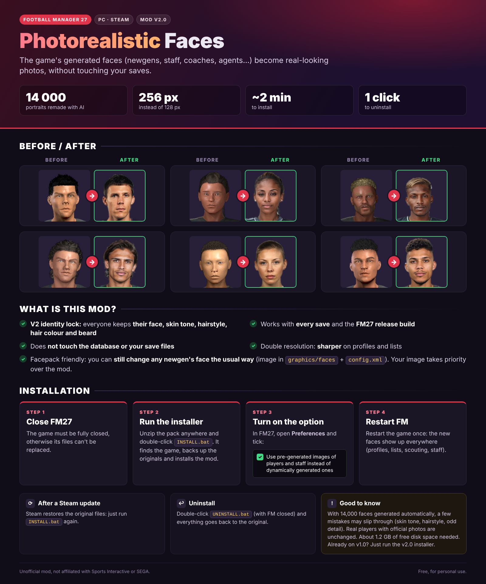

# FM27 Photorealistic Faces

Photorealistic, AI-remade versions of **all 14,000 generated portraits** in Football Manager 27 (newgens, staff, coaches, agents…).

🇫🇷 [Version française plus bas](#-version-française)

> **🆕 V2.1 for FM27 27.1.0 (17 Nov 2026).** Today's FM27 update added 956 portraits the game was missing, so older zips no longer install ("Unrecognised game version"). **[Download V2.1](https://github.com/amnesix-nt/FM27-Photorealistic-Faces/releases/tag/v2-progression)**

## What it does

- Replaces the game's pre-generated 3D-style portraits with realistic photos, at **256 px** instead of 128 px.
- Everyone keeps their face, skin tone, hairstyle, hair colour and beard.
- Works with every save, existing or new. It does not touch the database or your save files.
- V2.1 works with FM27 27.1.0 (Steam update of 17 Nov 2026). v2.0.1 is for the earlier release build.
- Facepack friendly: you can still change any newgen's face the usual way (image in `graphics/faces` + `config.xml`). Your image takes priority over the mod.
- Real players with official photos are unchanged.
- People the game shows as a black silhouette (real database people without a photo) stay as silhouettes: the mod only replaces generated portraits.

## What's new in V2

- **Identity lock:** each portrait is regenerated while locking the original face, so the person really looks like the same person, only real.
- **Sharper, more natural images**, with cleaner cut-outs around the head and shoulders.
- **Hair fixes:** fringes, long hair over the shoulders, and the green or olive tints seen in v1.0 are gone.
- **Automatic quality checks:** every portrait is checked against the original to catch failed ones.

## Download

Get the latest zip, **V2.1** for FM27 27.1.0 (~570 MB): **[FM27-Photoreal-Faces-v2-progression.zip](https://github.com/amnesix-nt/FM27-Photorealistic-Faces/releases/tag/v2-progression)**. It has the 14,000 photorealistic V2 portraits plus the 956 new faces added by the 27.1.0 update (upscaled for now, photoreal versions to follow).

Still on the game version before 17 Nov 2026? Use [v2.0.1](https://github.com/amnesix-nt/FM27-Photorealistic-Faces/releases/tag/v2.0.1). Older versions are on the [Releases](../../releases) page.

Already on v1.0? No need to uninstall: just run the new installer, it replaces the old version.

## Install (about 2 minutes)

1. **Close FM27** completely.
2. Unzip the pack anywhere and double-click **`INSTALL.bat`**. It finds the game, backs up the original files and installs the mod.
3. In FM27, open **Preferences** and tick the option to use **pre-generated images of players and staff** instead of dynamically generated ones.
4. **Restart FM** once. The new faces show up everywhere.

**After a Steam update:** Steam restores the original files, so just run `INSTALL.bat` again.
**Uninstall:** run `UNINSTALL.bat` with FM closed and everything goes back to the original.

Requirements: FM27 on PC (Windows), about 1.2 GB of free disk space. Works with the **Steam** version and, as confirmed by a player, the **Xbox Game Pass** version.

**Game Pass / other versions:** if the installer can't find the game, it asks for the game folder. For Game Pass, enter `C:\XboxGames\Football Manager 27\Content` (adjust the drive if you installed it elsewhere).

## Known limitations

- FM picks the **closest** pre-rendered portrait (sex, ethnicity, skin tone, hairstyle, hair colour, beard), not an exact match. A person can therefore get a portrait that differs a little from their 3D look, for example hair on a bald person.
- The game does not use age to choose a portrait, so everyone looks about 25, including older staff. Age-based portraits are being worked on for a future edition.
- With 14,000 faces generated automatically, a few mistakes may still slip through.

## How it works

FM27 ships 14,000 pre-rendered 128 px portraits in `portraits_assets_all.bundle`. Each one was regenerated with an SDXL photoreal model (img2img + ControlNet), with an IP-Adapter identity lock that keeps the original's features, a dedicated hair pass, skin-tone matching to the original and an automatic similarity check. The results are repacked into the bundle at 256 px. The installer updates the CRC and size of that bundle in the game's Addressables catalog so the game accepts it.

## Disclaimer

Unofficial, free fan mod. Not affiliated with or endorsed by Sports Interactive or SEGA. Football Manager is a trademark of Sports Interactive / SEGA.

---

## 🇫🇷 Version française

> **🆕 V2.1 pour FM27 27.1.0 (17/11/2026).** La mise à jour de FM27 a ajouté 956 portraits qui manquaient au jeu : les anciens zips ne s'installent plus (« version non reconnue »). **[Télécharger la V2.1](https://github.com/amnesix-nt/FM27-Photorealistic-Faces/releases/tag/v2-progression)**

Les **14 000 portraits générés** de Football Manager 27 (newgens, staff, entraîneurs, agents…) refaits en photo réaliste par IA, en **256 px** au lieu de 128 px.

- Chaque personne garde son visage, son teint, sa coiffure, sa couleur de cheveux et sa barbe.
- Marche avec toutes les sauvegardes, en cours ou nouvelles. Ne touche ni à la base de données ni à vos sauvegardes.
- La V2.1 fonctionne avec FM27 27.1.0 (mise à jour Steam du 17/11/2026). La v2.0.1 est pour la version précédente.
- Compatible facepacks : vous pouvez toujours changer la tête d'un newgen par la méthode classique (`graphics/faces` + `config.xml`). Votre image passe avant celle du mod.
- Les vrais joueurs avec photo officielle ne changent pas.
- Les personnes que le jeu affiche en silhouette noire (vraies personnes de la base sans photo) restent en silhouette : le mod ne remplace que les portraits générés.

**Nouveautés de la V2 :**
- **Verrou d'identité :** chaque portrait est régénéré en verrouillant le visage d'origine. C'est vraiment la même personne, en vrai.
- **Images plus nettes et plus naturelles**, avec des détourages plus propres autour de la tête et des épaules.
- **Cheveux corrigés :** franges, cheveux longs sur les épaules, et teintes vertes ou olive de la v1.0 supprimées.
- **Contrôle qualité automatique :** chaque portrait est comparé à l'original pour repérer les ratés.

**Téléchargement :** la **V2.1** pour FM27 27.1.0 (~570 Mo) : **[FM27-Photoreal-Faces-v2-progression.zip](https://github.com/amnesix-nt/FM27-Photorealistic-Faces/releases/tag/v2-progression)**, avec les 14 000 portraits V2 et les 956 nouveaux visages de la 27.1.0 (agrandis pour l'instant, version photoréaliste à venir). Jeu pas encore à jour ? Prenez la [v2.0.1](https://github.com/amnesix-nt/FM27-Photorealistic-Faces/releases/tag/v2.0.1). Les anciennes versions sont dans les [Releases](../../releases). Vous aviez la v1.0 ? Pas besoin de la désinstaller : lancez le nouvel installateur, il la remplace.

**Installation :**
1. Fermez FM27.
2. Dézippez le pack et double-cliquez sur **`INSTALLER.bat`**.
3. Dans les Préférences de FM27, cochez « Utilisez des images pré-générées des joueurs et du personnel plutôt que des images générées dynamiquement ».
4. Redémarrez FM.

Après une mise à jour Steam, relancez `INSTALLER.bat`. Pour désinstaller : `DESINSTALLER.bat` (FM fermé). Il faut FM27 sur PC (Windows) et environ 1,2 Go d'espace libre. Marche avec la version **Steam** et, d'après un joueur, la version **Xbox Game Pass**.

**Game Pass / autres versions :** si l'installateur ne trouve pas le jeu, il demande son dossier. Pour le Game Pass, indiquez `C:\XboxGames\Football Manager 27\Content` (changez la lettre du lecteur si le jeu est ailleurs).

**Limites connues :**
- FM choisit le portrait **le plus proche** (sexe, origine, teint, coiffure, couleur de cheveux, barbe), pas un portrait exact. Une personne peut donc avoir un portrait un peu différent de son apparence 3D, par exemple des cheveux alors qu'elle est chauve.
- Le jeu ne tient pas compte de l'âge pour choisir le portrait : tout le monde paraît environ 25 ans, y compris le staff âgé. Des portraits selon l'âge sont en préparation pour une prochaine édition.
- Avec 14 000 visages générés automatiquement, quelques erreurs peuvent encore se glisser.

Mod gratuit et non officiel, non affilié à Sports Interactive ni à SEGA.
