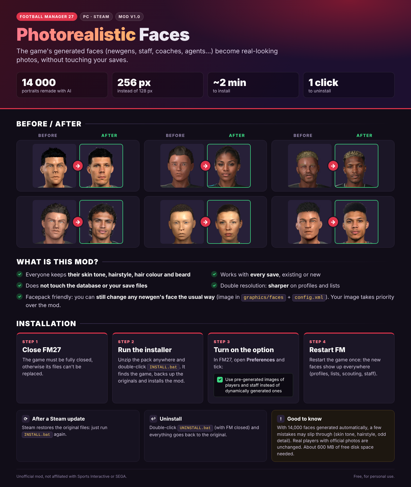
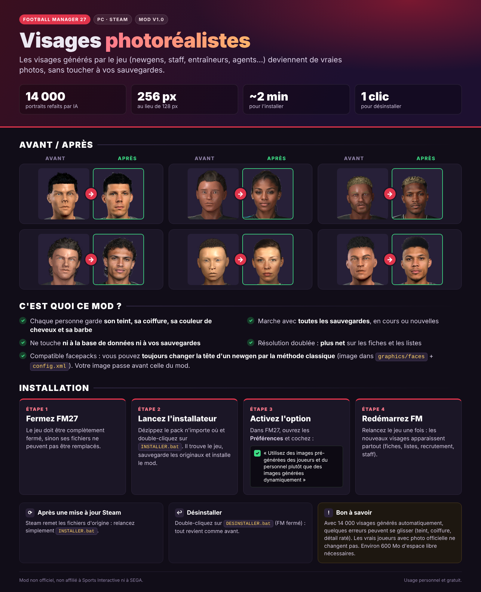

# FM27 Photorealistic Faces

Photorealistic, AI-remade versions of **all 14,000 generated portraits** in Football Manager 27 (newgens, staff, coaches, agents…).

🇫🇷 [Version française plus bas](#-version-française)

## What it does

- Replaces the game's pre-generated 3D-style portraits with realistic photos, at **256 px** instead of 128 px.
- Everyone keeps their skin tone, hairstyle, hair colour and beard.
- Works with every save, existing or new. It does not touch the database or your save files.
- Facepack friendly: you can still change any newgen's face the usual way (image in `graphics/faces` + `config.xml`). Your image takes priority over the mod.
- With 14,000 faces generated automatically, a few mistakes may slip through (skin tone, hairstyle, odd detail).
- Real players with official photos are unchanged.
- People the game shows as a black silhouette (real database people without a photo) stay as silhouettes: the mod only replaces generated portraits.

## Download

Get the latest zip (~400 MB) from the **[Releases](../../releases)** page.

## Install (about 2 minutes)

1. **Close FM27** completely.
2. Unzip the pack anywhere and double-click **`INSTALL.bat`**. It finds the game, backs up the original files and installs the mod.
3. In FM27, open **Preferences** and tick the option to use **pre-generated images of players and staff** instead of dynamically generated ones.
4. **Restart FM** once. The new faces show up everywhere.

**After a Steam update:** Steam restores the original files, so just run `INSTALL.bat` again.
**Uninstall:** run `UNINSTALL.bat` with FM closed and everything goes back to the original.

Requirements: FM27 on PC (Steam), about 600 MB of free disk space.

## How it works

FM27 ships 14,000 pre-rendered 128 px portraits in `portraits_assets_all.bundle`, picked by sex, ethnicity, skin tone, hairstyle, hair colour and beard. Each portrait was regenerated with an img2img + ControlNet pipeline (SDXL photoreal model) that keeps the original's features and skin tone, then repacked into the bundle at 256 px. The installer updates the CRC and size of that bundle in the game's Addressables catalog so the game accepts it.

## Disclaimer

Unofficial, free fan mod. Not affiliated with or endorsed by Sports Interactive or SEGA. Football Manager is a trademark of Sports Interactive / SEGA.

---

## 🇫🇷 Version française

Les **14 000 portraits générés** de Football Manager 27 (newgens, staff, entraîneurs, agents…) refaits en photo réaliste par IA, en **256 px** au lieu de 128 px.

- Chaque personne garde son teint, sa coiffure, sa couleur de cheveux et sa barbe.
- Marche avec toutes les sauvegardes, en cours ou nouvelles. Ne touche ni à la base de données ni à vos sauvegardes.
- Compatible facepacks : vous pouvez toujours changer la tête d'un newgen par la méthode classique (`graphics/faces` + `config.xml`). Votre image passe avant celle du mod.
- Avec 14 000 visages générés automatiquement, quelques erreurs peuvent se glisser.
- Les vrais joueurs avec photo officielle ne changent pas.
- Les personnes que le jeu affiche en silhouette noire (vraies personnes de la base sans photo) restent en silhouette : le mod ne remplace que les portraits générés.

**Téléchargement :** le zip (~400 Mo) est dans les **[Releases](../../releases)**.

**Installation :**
1. Fermez FM27.
2. Dézippez le pack et double-cliquez sur **`INSTALLER.bat`**.
3. Dans les Préférences de FM27, cochez « Utilisez des images pré-générées des joueurs et du personnel plutôt que des images générées dynamiquement ».
4. Redémarrez FM.

Après une mise à jour Steam, relancez `INSTALLER.bat`. Pour désinstaller : `DESINSTALLER.bat` (FM fermé).

Mod gratuit et non officiel, non affilié à Sports Interactive ni à SEGA.
